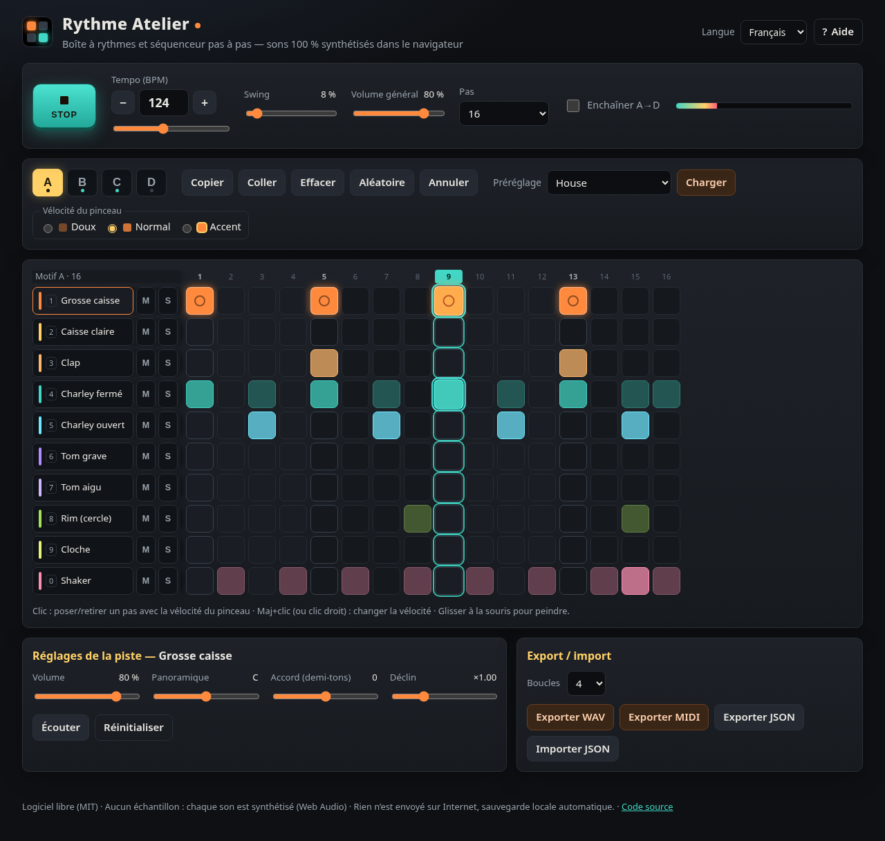
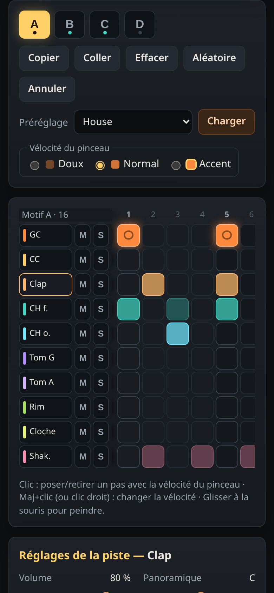

# Rythme Atelier 🥁

**Boîte à rythmes et séquenceur pas à pas gratuit, 100 % dans le navigateur.**
Tous les sons (grosse caisse, caisse claire, clap, charleys, toms, rim, cloche, shaker) sont **synthétisés en direct avec la Web Audio API** : aucun échantillon, donc aucun problème de licence. Export **WAV**, **MIDI** (General MIDI, canal 10) et **JSON**. Interface en **français**, **anglais** et **taqbaylit**.

🔗 **Démo en ligne : https://salimadour31-boop.github.io/rythme-atelier/**

| Ordinateur | Mobile |
|---|---|
|  |  |

## Fonctionnalités

- **10 voix synthétisées** : grosse caisse, caisse claire, clap, charley fermé / ouvert (le fermé coupe l’ouvert, comme sur une vraie batterie), tom grave / aigu, rim, cloche (cowbell), shaker.
- **Grille de 12, 16, 24 ou 32 pas** (12/24 = mesures en 6/8, 16/32 = 4/4) ; en passant à une longueur plus grande, la mesure est recopiée automatiquement.
- **Vélocité par pas** : doux, normal, accent (pinceau de vélocité, Maj+clic ou clic droit pour faire défiler, glisser à la souris pour peindre).
- **Par piste** : volume, panoramique, accord (±12 demi-tons), déclin, muet / solo, écoute.
- **Tempo 40 à 240 BPM**, **swing** 0–100 %, volume général avec saturation douce (pas de clipping numérique), VU-mètre.
- **Banque de 4 motifs (A–D)** : copier / coller, effacer, aléatoire « musical », annuler (Ctrl+Z), **enchaînement A→D**.
- **8 préréglages originaux** : house, techno, hip-hop boom bap, trap (32 pas), rock, reggae one drop, **chaabi 6/8**, funk.
- **Planification audio précise** (« lookahead » de 120 ms sur l’horloge de l’AudioContext, minuterie dans un Web Worker) et tête de lecture visuelle.
- **Exports** : WAV 16 bits stéréo 44,1 kHz (rendu hors-ligne `OfflineAudioContext` de 1 à 16 boucles), **fichier MIDI standard** (format 0, notes GM batterie sur le canal 10, tempo, swing et mesure 4/4 ou 6/8), projet **JSON** (import / export).
- **Sauvegarde automatique** locale (localStorage). Rien n’est envoyé sur Internet, aucun traceur, aucune dépendance externe (pas de CDN).
- **Accessible** : tous les contrôles sont étiquetés, focus visibles, grille navigable au clavier (flèches + Entrée), messages annoncés aux lecteurs d’écran.
- **Responsive** : ordinateur et mobile (la grille défile horizontalement sur petit écran).

## Utilisation

1. Ouvrez la [démo](https://salimadour31-boop.github.io/rythme-atelier/) (ou `index.html` en local, aucun serveur ni installation nécessaire).
2. Choisissez un préréglage ou cliquez dans la grille pour poser des pas.
3. Appuyez sur **Lecture** (ou la barre **Espace**), réglez le tempo et le swing.
4. Exportez votre rythme en **WAV** pour votre montage, en **MIDI** pour votre logiciel de musique (DAW), ou en **JSON** pour le retrouver plus tard.

### Raccourcis clavier

| Touche | Action |
|---|---|
| `Espace` | Lecture / stop |
| `A` `B` `C` `D` | Choisir le motif |
| `1` … `0` | Jouer les 10 sons (Maj = accent) |
| `+` / `-` | Tempo ±1 (Maj : ±10) |
| Flèches, `Entrée` | Se déplacer dans la grille, poser / retirer un pas |
| `M` / `S` | Muet / solo de la piste sélectionnée |
| `Ctrl`+`Z` | Annuler |
| `?` | Aide |

### Correspondance MIDI (General MIDI, canal 10)

Grosse caisse 36 · Rim 37 · Caisse claire 38 · Clap 39 · Charley fermé 42 · Tom grave 45 · Charley ouvert 46 · Tom aigu 50 · Cloche 56 · Shaker (maracas) 70. Vélocités : doux 56, normal 96, accent 127.

## Structure du code

```
index.html      page unique
style.css       thème sombre « studio »
js/core.js      logique pure : modèle, préréglages, swing, encodeurs WAV et MIDI, validation JSON
js/synth.js     synthèse des 10 voix (Web Audio), table de mixage, rendu hors-ligne
js/i18n.js      textes FR / EN / Taqbaylit
js/app.js       interface, séquenceur « lookahead », sauvegarde, exports
tests/          tests unitaires (Node) et de bout en bout (Playwright)
```

### Tests

```bash
node tests/unit.js                                   # tests unitaires, sans dépendance
npm i playwright && npx playwright install chromium  # (en dehors du dépôt)
python3 -m http.server 8765 &
RA_URL=http://localhost:8765/ node tests/e2e.js      # SHOTS=1 pour régénérer les captures
```

> La traduction taqbaylit est faite au mieux ; les corrections sont les bienvenues (issue ou pull request).

---

## English

**Rythme Atelier** is a free, open-source **drum machine / step sequencer** that runs entirely in your browser. All ten sounds (kick, snare, clap, closed/open hi-hat with choke, low/high tom, rimshot, cowbell, shaker) are **synthesized live with the Web Audio API** — no samples, no licensing issues.

**Demo:** https://salimadour31-boop.github.io/rythme-atelier/

**Features:** 12/16/24/32-step grid (6/8 or 4/4), per-step velocity (soft / normal / accent), per-track volume, pan, tune and decay, mute/solo, 40–240 BPM, swing, 4-pattern bank (A–D) with copy/paste/clear/randomize/undo and A→D chaining, 8 original genre presets (house, techno, boom bap, trap, rock, reggae one drop, chaabi 6/8, funk), sample-accurate lookahead scheduling with a visual playhead, keyboard shortcuts (Space = play/stop), autosave, **WAV export** (OfflineAudioContext render of 1–16 loops), **Standard MIDI File export** (GM drum map, channel 10), JSON import/export. UI in French, English and Taqbaylit. Single static page, no build step, no CDN, no trackers, keyboard-accessible and responsive.

**Usage:** open the demo (or `index.html`), pick a preset or click steps, press Space, then export to WAV / MIDI / JSON.

## Licence / License

[MIT](LICENSE) © 2026 Amirouche Amwanes
